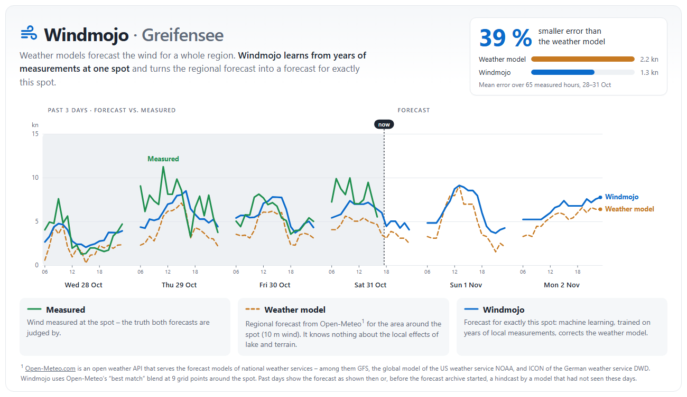

[](https://github.com/marioland/windmojo/actions/workflows/ci.yml)

# Windmojo - ML-Powered Wind Forecasting for Any Location

**Find your wind mojo with location-specific ML forecasts**



*The forecast page (`python cli.py serve`): the past days compare both forecasts with the measurements,
then the forecast for the next days. Greifensee, Switzerland, October 2026.*

## What Windmojo Does

Weather models forecast the wind on a grid of a few kilometres. At a particular spot the
real wind is often stronger, weaker or comes at a different time. Windmojo learns these
systematic local errors from your own wind measurements and corrects the forecast for
exactly that spot. Meteorologists call this statistical post-processing *Model Output
Statistics* (MOS); Windmojo does it with one XGBoost model per spot.

You provide:

1. **Hourly wind measurements** of your station (1 year recommended, 2-3 years better)
2. **Coordinates and time zone** of the station

Windmojo then:
- Downloads past weather forecasts for 9 points around the station from
  [Open-Meteo](https://open-meteo.com/) (free API, no key needed for non-commercial use)
- Engineers ~380 features (pressure and cloud gradients across the grid, vertical wind
  and temperature profile, lags, rolling statistics)
- Trains one XGBoost model for all hours that turns these into the local hourly mean wind
- Validates the model on test days it has not seen and draws diagrams against the measurements
- Produces live forecasts as JSON and as a forecast page for your computer or website

On Greifensee (Switzerland) the forecast for the same day is 15 % more accurate than the
weather model's wind, calibrated to the spot, on Lake Como (Dervio) about 10 %; the
advantage shrinks with every day ahead (see [Results](#results)).

**Terms used:** *weather model* means the raw forecast from Open-Meteo's `best_match` blend
(models of national weather services such as DWD ICON, ECMWF IFS and NOAA GFS). In the code
and the validation diagrams this raw forecast is labelled "GFS" for historical reasons.

## Quick Start

```bash
git clone https://github.com/marioland/windmojo.git && cd windmojo
uv sync                                   # Python environment + `windmojo` command

# A new spot, in this order (details: "Step by Step: A New Spot" below)
uv run python -m windmojo.data_fetcher --config config/<area>/<spot>.yaml --mode historical
uv run python -m windmojo.feature_engineer --config config/<area>/<spot>.yaml
uv run python cli.py migrate --from-dir data/<area>/<spot> --to-spot <spot>
uv run python cli.py train --spot <spot>
uv run python cli.py evaluate --spot <spot>     # test metrics + validation diagrams

# Live forecast
uv run python cli.py predict --spot <spot>      # JSON for websites
uv run python cli.py serve --spot <spot>        # forecast page on http://localhost:8000/
```

`uv run windmojo <command>` is the same as `uv run python cli.py <command>`.

**Forecasts on your website:** [DEPLOYMENT.md](DEPLOYMENT.md) explains how to run the
forecast on a schedule and show it on any website — including shared web hosting
without Python (cron on the host, GitHub Actions + SFTP, or own server), with a
ready-made forecast page in [`web/`](web/index.html).

---

## Why Windmojo?

Global weather models (GFS, ECMWF) provide general wind forecasts, but they often miss crucial local effects:
- **Thermal winds** (sea/lake breezes, mountain/valley winds)
- **Topographic channeling** (canyon winds, gap flows)
- **Local convergence zones** (land-sea boundaries)
- **Micro-climate effects** (urban heat islands, local heating)

Windmojo learns these location-specific patterns from your historical wind data and creates a custom ML model.
How much it gains depends on the spot: it can only correct what shows up in the weather
model's inputs (see [Limitations](#limitations)).

### Primary Use Cases

- **Wind Sports**: Kitesurfing, windsurfing, wingfoiling, sailing, paragliding
- **Coastal Locations**: Sea breeze prediction
- **Lake Environments**: Thermal wind forecasting (Ora, Breva, Pelér patterns)
- **Mountain Valleys**: Katabatic and anabatic wind systems

---

## Results

Walk-forward evaluation: the model is trained only on data before each test period, as
in real use. The baseline is the weather model's 10 m wind at the station, linearly
calibrated on the same training data (a fair baseline: plain bias correction).

| Spot | Wind type | Data | Test | Windmojo MAE | Weather model, calibrated |
|------|-----------|------|------|--------------|---------------------------|
| Greifensee, Switzerland | frontal and gradient wind | 5.6 years (2021-2026) | 15 test quarters | **0.69 m/s** | 0.81 m/s |
| Dervio, Lake Como | thermal valley winds | 9 months (2025) | monthly blocks | **1.53-1.56 m/s** | 1.69-1.74 m/s |

**By lead time** (Greifensee, forecasts made 0-6 days ahead, from 2024-01-25):

| Days ahead | 0 | 1 | 2 | 3 | 6 |
|------------|---|---|---|---|---|
| Windmojo MAE (m/s) | 0.66 | 0.76-0.80 | 0.84-0.86 | 0.89-0.91 | 1.05-1.10 |
| Weather model, calibrated | 0.79 | 0.86 | 0.92 | 0.96 | 1.11 |

A forecast from climatology alone has an MAE of 1.15 m/s. The model is trained on
same-day forecasts and treats uncertain forecasts for later days like sharp ones: from
the next day on it forecasts strong wind too often (3 days ahead, forecasts of ≥ 4 m/s
are on average about 1 m/s too high, and every fifth forecast windy day stays calm).

**Strong wind** (Greifensee, ≥ 4 m/s, 15 % of the hours): when the model forecasts
≥ 4 m/s it is right on average. A single hourly value detects about half of the hours with
≥ 4 m/s, at 21 % false alarms. Hours with measured strong wind look about 1 m/s too low
in the forecast; that is regression to the mean, not a bias of the model.

Details: [FEATURE_RELEVANCE.md](research/03_FEATURE_ENGINEERING/FEATURE_RELEVANCE.md) and
[SIMPLIFIED_ARCHITECTURE.md](SIMPLIFIED_ARCHITECTURE.md#performance).

---

## Requirements

### Input Data

- **Hourly wind measurements**: tested with 9 months (Dervio) to 5.6 years (Greifensee).
  Less than a year leaves seasons out of the training; 1 year is the recommended minimum,
  2-3 years are better
- Values at the full hour (aggregate 10-minute data to hourly means first), less than 20 % missing
- **Coordinates and time zone** of the station

**Data Format:**
CSV with a `timestamp` column in the format `YYYY-MM-DD_HHMM`, local time of the
spot's configured `timezone`. Wind speed in m/s, km/h, knots or mph (set `target.unit`
in the config, default m/s); the column name is set in the config.

```csv
timestamp,dervio speed,dervio direction
2024-01-01_0000,5.2,180
2024-01-01_0100,4.8,175
```

See [data/README.md](data/README.md#measurement-file-format) for details.

### Where to Get Measurements

Windmojo does not download measurements; you bring them as CSV. Possible sources:

- Your own anemometer or weather station (ultrasonic or cup, mounted free of obstacles)
- Open data of national weather services (e.g. MeteoSwiss stations in Switzerland)
- Research platforms on lakes and coasts (e.g. [Eawag Datalakes](https://www.datalakes-eawag.ch/)
  for Swiss lakes; the screenshot above uses its Greifensee platform)
- Station networks of wind sports clubs or schools

Check the terms of use of the provider, especially before showing measurements on a website.

---

## Key Features

### 8+1 Circular Grid Architecture

Windmojo downloads the weather model at **9 points**: the measurement location (center)
and 8 points at the compass directions N, NE, E, SE, S, SW, W, NW, all at the same
distance from the center (`grid.radius_km` in the config, default 20 km).

*Perimeter points (8):* sea-level pressure and cloud cover (total, low, mid, high) — enough
for pressure and cloud gradients across the spot.

*Center point:* the full variable set —
- Surface: temperature, humidity, dew point, pressure, precipitation, rain, showers,
  snowfall, snow depth, weather code, visibility
- Wind at 10, 80, 120 and 180 m, gusts at 10 m; temperature at 80-180 m
- Radiation (shortwave, direct, diffuse), soil temperature and moisture
- Pressure levels 1000, 850, 700, 500 and 250 hPa: temperature, humidity, clouds, wind,
  geopotential height

Hours per day: 06:00-23:00 local time (`forecast.initialization_time` and
`horizon_hours`), no night hours. Full variable list: `windmojo/data/grid_downloader.py`.

Why a circle instead of a dense grid: about 9 requests per day instead of hundreds, aligned with
how wind directions are described, and the radius can be adapted to the scale of the
local wind system (narrow valley vs. wide lake).

### Feature Engineering

Windmojo engineers **~380 features** from the downloaded data (384 on Greifensee; list in
[`tests/feature_names.txt`](tests/feature_names.txt)):

- **Spatial:** pressure gradients between the center and each perimeter point and across
  the grid (N–S, NW–SE, ...), cloud cover gradients
- **Vertical:** wind speed and direction shear between 10-180 m and the pressure levels,
  temperature lapse rates, bulk Richardson number (stability)
- **Temporal:** lags (1h, 3h, 6h, 1d, 2d, 3d), rolling statistics (3h to 7d), change
  rates, hours since rain or snowfall. No feature looks back more than 7 days, so live
  forecasts get exactly the training features
- **Calendar:** hour and month (also as sine/cosine)
- **Snow and surface indicators**

### Training Pipeline

One XGBoost model for all hours (`python cli.py train`):
- Uses every feature of the pipeline. XGBoost copes with redundant and weak features;
  a separate feature selection (the former Phase 1/2) brought no gain in walk-forward
  tests on two lakes
- Hour of day is a feature (`hour`, `hour_sin`, `hour_cos`), so one model covers the daily cycle
- Early stopping on every 10th training day; metrics on separate test days
- The loss tolerates timing errors of up to ±3 h: a wind peak forecast an hour early is not
  punished twice (false alarm + miss). On Greifensee this misses 5 percentage points fewer
  windy days (≥ 4 m/s) at the same MAE. The hourly value means "this wind around this hour".
  On Dervio (thermal winds at regular times) there is no such gain, and strong wind is hit
  less often at the exact hour; for thermal spots compare with `time_tolerance.hours: 0`

What matters for the forecast and why: [FEATURE_RELEVANCE.md](research/03_FEATURE_ENGINEERING/FEATURE_RELEVANCE.md)

### Output

- **Trained model**: `models/model.json` and `models/metadata.json` (features, training
  medians, metrics, parameters)
- **Validation metrics**: MAE, RMSE, R² and bias on the test days (`cli.py evaluate`)
- **Validation diagrams**: one PNG per test month, Windmojo vs. weather model vs. measurements
- **Live forecast**: JSON for websites (`cli.py predict`, format in
  [DEPLOYMENT.md](DEPLOYMENT.md#4-json-format)); every forecast is archived for later
  verification
- **Forecast page**: `cli.py serve` shows forecast, past days and CSV downloads locally

---

## Installation

### Prerequisites

- **Python**: 3.10 or higher
- **Internet Connection**: For downloading weather data
- **UV Package Manager**: Modern Python package manager

### 1. Install UV Package Manager

**macOS / Linux / WSL:**
```bash
curl -LsSf https://astral.sh/uv/install.sh | sh
```

**Windows 11 (PowerShell):**
```powershell
powershell -c "irm https://astral.sh/uv/install.ps1 | iex"
```

Restart terminal after installation.

### 2. Clone Repository

```bash
git clone https://github.com/marioland/windmojo.git
cd windmojo
```

### 3. Install Dependencies

```bash
uv sync
```

This also installs the `windmojo` command (`uv run windmojo --help`).

---

## Step by Step: A New Spot

Download and feature engineering still use the legacy `data/[area]/[spot]/` layout and
config format; training and forecasts use `data/spots/[spot]/`. `cli.py migrate` moves a
spot from one to the other (background: [data/README.md](data/README.md)).

### 1. Prepare Your Data

```
data/[area]/[spot]/measurements/wind_data.csv
```

Example:
```
data/lake_como/dervio/measurements/wind_data.csv
```

**CSV Format** (`timestamp` must be `YYYY-MM-DD_HHMM`, local time):
```csv
timestamp,dervio speed,dervio direction
2024-01-01_0000,5.2,180
2024-01-01_0100,4.8,175
```

### 2. Configure Your Location (legacy format)

Create `config/[area]/[spot].yaml`:

```yaml
location_name: "Dervio, Lake Como"
area: "lake_como"
spot: "dervio"

center:
  latitude: 46.083333
  longitude: 9.3

measurement_file: "data/lake_como/dervio/measurements/wind_data.csv"
measurement_unit: "km/h"   # unit of the speed column (default m/s)
timezone: "Europe/Rome"

grid:
  radius_km: 20  # Distance to perimeter points
```

### 3. Download Historical Forecasts

```bash
uv run python -m windmojo.data_fetcher \
  --config config/lake_como/dervio.yaml \
  --mode historical
```

The date range comes from the measurement file; one Parquet file per day lands in
`data/lake_como/dervio/raw/`. Days that already exist are skipped, so an interrupted
download can simply be restarted.

**Mind the Open-Meteo limits.** The free API allows about 430 days of history per hour
(about 30 minutes for one year), then requests fail ("Rate limit exceeded" in the log);
the daily limit is about twice that. Longer histories take several runs or an API key
(`OPEN_METEO_API_KEY`, see [DEPLOYMENT.md](DEPLOYMENT.md#12-licensing-and-data-protection)).

- At the first rate-limit message, stop the download (Ctrl+C) and restart it later.
  A day for which single grid points failed is still saved, and later runs skip it: delete
  the day files written after the first failure (the log names the failed grid points)
  before restarting.
- **Never use `--rerun` to resume**: it deletes all raw files of the spot before downloading.

### 4. Engineer Features

```bash
uv run python -m windmojo.feature_engineer \
  --config config/lake_como/dervio.yaml
```
*Time: 2-5 minutes*

### 5. Move to the New Layout and Convert the Config

```bash
uv run python cli.py migrate --from-dir data/lake_como/dervio --to-spot dervio
```

`migrate` copies measurements, raw data, features and the legacy config to
`data/spots/dervio/`. Replace the copied `input/config.yaml` with the simplified format:
start from [`config/examples/dervio.yaml`](config/examples/dervio.yaml) and set `spot`,
`name`, `latitude`, `longitude`, `timezone` and the `target` section (column names and
unit of your CSV). Instead of copies, the config can point into the legacy layout with
`paths` (see [data/README.md](data/README.md)).

### 6. Train and Evaluate

```bash
uv run python cli.py train --spot dervio
uv run python cli.py evaluate --spot dervio
```
*Time: about a minute*

### 7. Generate Forecasts

```bash
uv run python cli.py predict --spot dervio   # data/spots/dervio/forecasts/forecast.json
uv run python cli.py serve --spot dervio     # http://localhost:8000/
```

**Total pipeline time:** mostly the download (about 30 minutes per year of data on the free tier)
**Daily forecast time:** under a minute

---

## Theory vs. Practice

The [research notes](research/) describe the physics of local wind. Measurements at
Greifensee (5.6 years) and Dervio (9 months) confirm the mechanisms, but not the expected
ranking of features:

- **Confirmed:** daytime mixing brings the upper-air wind down (Greifensee: correlation with
  the 850 hPa wind 0.27 in stable, 0.51 in unstable conditions); a small lake makes no lake
  breeze (Greifensee, 1.6 km wide: sunshine correlates negatively with wind); valley winds on
  Lake Como (Dervio: strong wind from N/NE in the morning, from S/SW in the afternoon);
  channelling along the lake axis (strongest pressure feature at Greifensee: the NW–SE gradient).
- **Not confirmed:** the expected importance (pressure gradients 30–40 %, synoptic indices
  20–30 %, thermal features 15–25 %). The weather model's surface wind takes about half of
  the gain, pressure gradients 4–7 %; synoptic and jet-level features add nothing. The model
  corrects the weather model's forecast, which already turns pressure gradients into wind;
  synoptic indices act on longer time scales. The earlier finding that 30–75 selected
  features work best was not tested on independent data.
- **Open:** the largest errors occur where the theory names drivers the model cannot see:
  thermal valley winds (Dervio: at measured ≥ 4 m/s the error is 2.6 m/s for the morning
  wind from the north, 1.5 m/s for the afternoon wind from the south; no radiation data in
  the Dervio download) and the cross-Alpine pressure gradient behind föhn, which a 20 km
  grid does not cover.

Details: [FEATURE_RELEVANCE.md](research/03_FEATURE_ENGINEERING/FEATURE_RELEVANCE.md)

---

## Data & File Structure

Windmojo is migrating from an `area/spot` layout to a flat `spots/` layout. Download and
feature engineering use the legacy layout; `cli.py train`, `evaluate`, `predict` and
`serve` use the new one (details in [data/README.md](data/README.md)):

```
windmojo/
├── cli.py                       # Command-line entry point (code in windmojo/cli.py)
├── config/
│   ├── examples/dervio.yaml     # Example config (simplified format)
│   └── [area]/
│       └── [spot].yaml          # Legacy location configuration
├── data/
│   ├── [area]/                  # Legacy layout
│   │   └── [spot]/
│   │       ├── measurements/
│   │       │   └── wind_data.csv   # Your wind measurements
│   │       ├── raw/             # Downloaded forecast data (Parquet)
│   │       └── features/        # Engineered features (Parquet)
│   └── spots/                   # New layout
│       └── [spot]/
│           ├── input/           # config.yaml + measurements.csv
│           ├── training/        # raw/, features/, validation/
│           ├── models/          # model.json + metadata.json
│           └── forecasts/       # forecast.json + archive (cli.py predict)
├── web/index.html               # Forecast page (cli.py serve, websites: DEPLOYMENT.md)
└── windmojo/                    # Source code
    ├── data/                    # Download from Open-Meteo
    ├── features/                # Feature engineering
    ├── training/                # Model training (cli.py train)
    ├── evaluation/              # Metrics and validation diagrams (cli.py evaluate)
    ├── prediction/              # Live forecasts (cli.py predict)
    └── web.py                   # Local forecast page (cli.py serve)
```

---

## CLI Reference

```bash
# Download past weather forecasts (date range from the measurement file)
uv run python -m windmojo.data_fetcher --config config/area/spot.yaml --mode historical

# Engineer features from the downloaded data
uv run python -m windmojo.feature_engineer --config config/area/spot.yaml

# Move the spot to the new layout (then convert its config to the simplified format)
uv run python cli.py migrate --from-dir data/area/spot --to-spot spot

# Train on all features; --until keeps later days unseen for an honest look back
uv run python cli.py train --spot spot [--until 2026-10-27]

# Test metrics and validation diagrams
uv run python cli.py evaluate --spot spot

# Live forecast as JSON (production use)
uv run python cli.py predict --spot spot --output path/to/spot.json

# Forecast page with update button, past days and CSV downloads
uv run python cli.py serve --spot spot [--port 8000]
```

All `cli.py` commands also work as `uv run windmojo <command>`. Options of `train`,
`evaluate` and `predict`: [SIMPLIFIED_ARCHITECTURE.md](SIMPLIFIED_ARCHITECTURE.md#cli-commands);
`serve` and running `predict` on a schedule: [DEPLOYMENT.md](DEPLOYMENT.md).

---

## FAQ

### How much wind data do I need?

- **Tested**: 9 months (Dervio) to 5.6 years (Greifensee)
- **Recommended**: at least 1 year, so that every season is in the training data
- **Better**: 2-3 years

### What wind measurement quality is required?

**Minimum Requirements:**
- Hourly values (aggregate finer data)
- Fixed location (not moving)
- Less than 20% missing data

**Quality Indicators:**
- ✅ Calibrated anemometer (ultrasonic or cup)
- ✅ Unobstructed location
- ⚠️ Personal weather stations (may need filtering)
- ❌ Smartphone/handheld measurements (too inconsistent)

### What's a "good" MAE?

It depends on how windy the spot is: MAE 0.7 m/s is good at Greifensee (mean wind
2.4 m/s), but weak at a spot with 6 m/s mean wind. Compare instead:

- with the weather model on the same days: `cli.py evaluate` shows its MAE next to
  Windmojo's. That is the raw weather model; against the weather model calibrated to the
  spot (the baseline in [Results](#results)) Greifensee and Dervio gain 10-15 %
- with the MAE on the windy hours that matter for your sport, not only the overall MAE

### Does it work for spots without thermal winds?

Yes. Greifensee is a frontal and gradient wind lake (strong wind mostly from W/NW, S/SE
and the NE Bise), Dervio a thermal valley wind spot. The gain is largest where the weather
model is systematically wrong at the spot and the cause shows up in its data (e.g.
channelling along a lake axis). Effects the weather model cannot see (a thermal wind that
needs a finer resolution, föhn) stay hard.

### Can I use multiple measurement stations?

Yes, one model per station: each station is its own spot with its own config and model
(`data/spots/<spot>/`). Shared training across stations is not implemented.

---

## Documentation

| Document | Content |
|----------|---------|
| This README | Overview, results, setting up a new spot |
| [SIMPLIFIED_ARCHITECTURE.md](SIMPLIFIED_ARCHITECTURE.md) | Config format, `train` / `evaluate` / `predict` in detail, model, test day strategies, library API |
| [DEPLOYMENT.md](DEPLOYMENT.md) | Forecast page (`serve`), forecasts on a website, JSON format, Open-Meteo terms |
| [data/README.md](data/README.md) | Directory layouts and measurement file format |
| [config/README.md](config/README.md) | The two config formats |
| [research/](research/) | Research notes: wind physics, feature ideas, experiments. Partly historical; current findings in [FEATURE_RELEVANCE.md](research/03_FEATURE_ENGINEERING/FEATURE_RELEVANCE.md) |
| [CONTRIBUTING.md](CONTRIBUTING.md) | Development setup and guidelines |
| [CHANGELOG.md](CHANGELOG.md) | Version history |

---

## Limitations

1. **Own measurements needed**: Windmojo corrects the weather model with your
   measurements; without at least several months of hourly data there is nothing to learn
2. **Lead time**: trained on same-day forecasts. The gain over the weather model shrinks
   from 16 % (same day) to a few percent at 6 days ahead, and from the next day on strong
   wind is forecast too often (see [Results](#results))
3. **Strong wind**: a single hourly value detects about half of the hours with ≥ 4 m/s; no
   probabilities and no gust forecast yet
4. **What the weather model cannot see**: the model only corrects what shows up in its
   inputs. Small thermal winds below the weather model's resolution and pressure
   gradients beyond the 20 km grid (föhn) remain the largest errors
5. **Download**: the Open-Meteo free tier limits the history download to about 430 days
   per hour
6. **Non-commercial use only** with the free Open-Meteo API (commercial websites need an
   API subscription, see [DEPLOYMENT.md](DEPLOYMENT.md#12-licensing-and-data-protection))
7. **Transitional layout**: download and feature engineering are not yet part of `cli.py`
   and still need the legacy layout and config

---

## Contributing

Contributions welcome! Areas of interest:
- Probabilistic output (chance of ≥ 4 m/s, quantiles) and a gust forecast
- Training on lead-time-specific forecasts
- `cli.py download` and `cli.py features` for the new spot layout
- Results for more spots (coastal, thermal, mountain)

See [CONTRIBUTING.md](CONTRIBUTING.md) for guidelines.

---

## License

Code: MIT, see [LICENSE](LICENSE).

Weather data: [Open-Meteo](https://open-meteo.com/), licensed under CC BY 4.0. The free
API is for non-commercial use only; see [DEPLOYMENT.md](DEPLOYMENT.md#12-licensing-and-data-protection).

---

## Acknowledgments

- **Weather Data**: Open-Meteo API (https://open-meteo.com/)
- **Numerical Models**: the national weather services behind Open-Meteo's `best_match`
  blend (e.g. DWD ICON, ECMWF IFS, NOAA GFS)
- **Measurements in the screenshot**: Eawag, [Datalakes](https://www.datalakes-eawag.ch/) (Greifensee)
- **ML Framework**: XGBoost, scikit-learn
- **Python Ecosystem**: pandas, numpy, matplotlib

---

## Roadmap

### Near-Term
- **Probabilistic forecasts**: chance of ≥ 4 m/s per hour and a gust forecast, instead of
  a single value only
- **Lead-time training**: `cli.py predict` archives the raw weather forecasts for tomorrow
  and the day after, the training data for forecasts more than a day ahead
- **Forecast verification**: compare the archived live forecasts with new measurements
- **Finish the spot layout**: `cli.py download` and `cli.py features`, no config conversion

### Mid-Term
- **More spots**: coastal and thermal spots beyond Greifensee and Lake Como
- **Multi-location training**: share learned patterns across similar locations
- **Alternative models**: LightGBM, neural networks for comparison

### Long-Term: Autonomous Research Loop

Inspired by [karpathy/autoresearch](https://github.com/karpathy/autoresearch) — an autonomous AI agent that modifies code, runs experiments, keeps improvements, and repeats indefinitely. The pattern maps naturally to Windmojo:

- **Agent explores** XGBoost hyperparameters, new features, probabilistic strong-wind forecasts, and training data weighting
- **XGBoost trains in seconds** (vs. 5 minutes for LLMs), enabling 1,000+ experiments overnight
- **Single metric** (walk-forward MAE) provides a clear optimization target
- **Feature selection is settled**: walk-forward tests showed that no subset beats all features ([FEATURE_RELEVANCE.md](research/03_FEATURE_ENGINEERING/FEATURE_RELEVANCE.md))

See [research/05_TOOLS_AND_METHODS/AUTORESEARCH.md](research/05_TOOLS_AND_METHODS/AUTORESEARCH.md) for full analysis.

---

**Find your wind mojo. Train your model. Catch the wind.**
